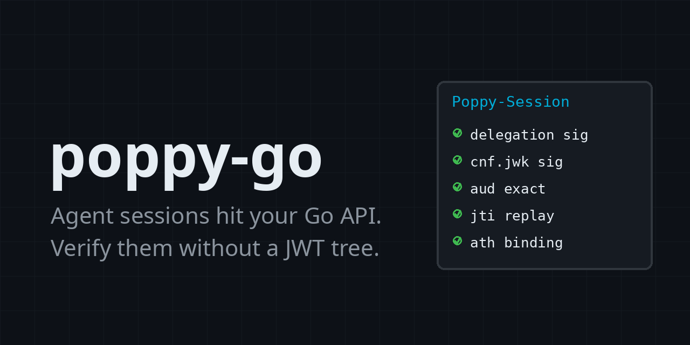

# poppy-go



Accept Personal Agent Protocol (Poppy) traffic in a Go backend without pulling in a framework: the discovery document, the `Poppy-Session` header with delegated keys, and agent client assertions as small, dependency-free packages.

[Poppy](https://personalagentprotocol.org/) (draft 1.0) is an open protocol that lets personal agents discover companies, run sessions, and act for users through APIs, web pages, and company agents. The [official company kit](https://github.com/personal-agent-protocol/personal-agent-protocol) is a coding-agent skill plus a Node validator. `poppy-go` is the Go library layer for the same company side: the pieces an API gateway or Go service needs before any business logic runs.

## What you get

| Package | What it does |
| --- | --- |
| `poppyjson` | Build, validate (spec MUST-level invariants), and serve `/.well-known/poppy.json` with correct content type and caching. |
| `session` | Verify the `Poppy-Session` header (spec 5.2, 5.3): a per-request `poppy-session+jwt` signed with ES256 by a delegated key, vouched for by a `poppy_dlg` delegation (ES256 or PS384) from the agent's `jwks_uri`. Checks run in spec order - delegation signature and 24-hour lifetime, signature against `cnf.jwk`, `kid` as RFC 7638 thumbprint, then `aud`, `htm`/`htu`, `iat`, `jti` replay, and `ath` token binding - plus the `Poppy-Version` gate (`version_unsupported`) and session continuity across rotated delegated keys. |
| `clientassert` | Verify the Personal Agent's `private_key_jwt` client assertion (RFC 7523) at your token endpoint: ES256 and PS384, `aud` equal to your issuer as a single string (arrays and the token endpoint URL rejected, spec 10.4), keys resolved from the agent's published metadata with a bounded HTTPS fetcher and cache. |

Every package is standard-library only. No `jwt` dependency tree, no framework lock-in: everything works on plain `net/http`.

## Install

```bash
go get github.com/ofershap/poppy-go
```

## Usage

Serve the discovery document:

```go
doc := &poppyjson.Document{
    ProtocolVersion: "1.0",
    Organization:    poppyjson.Organization{Name: "Example Store", Domain: "shop.example.com"},
    Auth: &poppyjson.Auth{
        Issuer: "https://shop.example.com",
        Scopes: map[string]string{"orders:read": "See your orders"},
    },
    APIs: []poppyjson.API{{Type: "rest", URL: "https://shop.example.com/orders", Description: "List orders"}},
}
h, err := poppyjson.Handler(doc, 3600) // fails fast on an invalid document
if err != nil { log.Fatal(err) }
mux.Handle(poppyjson.Path, h)
```

Verify the Session header on a resource request:

```go
v := &session.Verifier{
    Audience: "https://shop.example.com", // your company identifier (spec 3.2)
    Versions: []string{"1.0"},            // the protocol versions you serve
    Fetcher:  clientassert.NewClient(),   // cached, bounded, HTTPS-only agent metadata
}

func ordersHandler(w http.ResponseWriter, r *http.Request) {
    id, serr := v.VerifyRequest(r)
    if serr != nil {
        // serr.Code is "invalid_session" or "version_unsupported":
        // return HTTP 400 with {"error": serr.Code} (spec 5.3, 7).
        w.Header().Set("Content-Type", "application/json")
        w.WriteHeader(http.StatusBadRequest)
        fmt.Fprintf(w, `{"error":%q}`, serr.Code)
        return
    }
    // id.ClientID (the Personal Agent), id.UserID (pairwise per company),
    // id.SessionID, id.AgentID, id.AccessToken (whose validity is yours to check:
    // token errors are OAuth errors in WWW-Authenticate, not invalid_session).
}
```

Verify a Personal Agent's client assertion at your token endpoint:

```go
cv := &clientassert.Verifier{
    Issuer:  "https://shop.example.com", // aud must equal this, exactly
    Fetcher: clientassert.NewClient(),
    SeenJTI: replayCheck,                 // optional jti replay rejection (RFC 7523 §3)
}
a, err := cv.Verify(ctx, clientAssertion) // RFC 7523 private_key_jwt, ES256 or PS384
// a.ClientID is the verified agent identity; a rejected assertion gets invalid_client.
```

A runnable company deployment - discovery, RFC 8414/9728 metadata, token endpoint, and a protected `/orders` API - lives in [`exampleserver/`](exampleserver/) with `cmd/example-server`.

## How it was validated

- Unit tests, positive and adversarial negative cases for every check above, run with `-race` (`go test ./...`).
- The official Poppy Node validator ([kit/company/validate](https://github.com/personal-agent-protocol/personal-agent-protocol)) run against the example server on 2026-11-14: **54 passed, 0 failed, 0 warnings** for the `foundation` milestone (discovery, issuer metadata, Session header positive and negative cases, client assertions, version and token errors). The run was local: a self-signed certificate, and the validator's test agent hand-registered with the server, as the validator's README prescribes for local testing - the production metadata fetcher rightly refuses loopback client_ids.
- Not covered: `interfaces`, `sign-in`, and `extensions` milestones (OpenAPI, conversations, browser join, tasks, feedback), because the library doesn't implement those protocols.

## What it doesn't do

- Sign-in flows (Direct, Device, Mediated), token issuance policy, or consent UI. This library verifies credentials; your OAuth server issues tokens.
- Conversations, web browser-session handoff, tasks/feedback, or extensions. Discovery document fields exist; the protocols are out of scope.
- Conformance certification or a security audit. `poppy-go` targets Poppy draft 1.0, passes the official validator's foundation milestone locally as described above, and has **not** been independently security-audited. It is early-stage: evaluate it before trusting it with production traffic.

## Notes

- ES256 and PS384 are the supported signature algorithms, matching what the spec requires every company to accept (spec 4.1, 5.2).
- `htu` comparison follows RFC 9449 §4.2 (absolute URI without query or fragment).
- The jti replay cache and session store are per-process. Wrap `Verifier` with shared storage if you run many replicas and need strict cross-replica replay rejection.
- The metadata fetcher treats agent client_ids as untrusted URLs: https-only, the client_id document fetched without following redirects (spec 4.1), jwks_uri with https-only redirects, and only public IP destinations (checked per connection, including re-resolution). For agents inside a private network, supply your own `*http.Client` with an explicit destination policy.

<details>
<summary><strong>Q&amp;A</strong></summary>

**What is the Personal Agent Protocol (Poppy)?**
An open protocol (draft 1.0, initiated by Sierra) for companies and personal agents: a company publishes `/.well-known/poppy.json`, agents start sessions by sending a signed `Poppy-Session` header with each request, and sign-in runs through standard OAuth with `private_key_jwt` client assertions.

**Why delegated keys?**
A personal agent signs a fresh Session JWT for every request. Delegations keep those signatures off the keys in its `jwks_uri`: a jwks key signs a short-lived delegation (at most 24 hours) naming a delegated key, and each Session JWT carries its delegation. Companies verify the chain and never see which key signs what for whom beyond one session.

**Does poppy-go work with Gin/Echo/Fiber?**
Yes. Verification takes an `*http.Request` and returns plain values, so any framework that exposes the request works.

**Why not use a generic JWT library?**
The Poppy company side needs a fixed, narrow shape: the delegation chain, exact-match `aud`, pairwise user IDs, and agent metadata resolution with an untrusted-URL fetch policy. Implementing exactly that on the standard library keeps the dependency tree empty and the audited surface small.

**Is there an official Go SDK?**
No. The official company kit is a coding-agent skill plus a Node validator. poppy-go is an independent implementation of the same draft spec, checked against that validator.

</details>

---

## Contributing

Issues and PRs welcome - see [CONTRIBUTING.md](CONTRIBUTING.md). Please report security issues privately per [SECURITY.md](SECURITY.md).

---

More projects: [gitshow](https://github.com/ofershap/gitshow) · [real-browser-mcp](https://github.com/ofershap/real-browser-mcp) · [cursor-usage-tracker](https://github.com/ofershap/cursor-usage-tracker) · [mcp-server-markdown](https://github.com/ofershap/mcp-server-markdown) · [readme-builder](https://github.com/ofershap/readme-builder) · [grok-bot-skills](https://github.com/ofershap/grok-bot-skills) · [mashov-parent-brief](https://github.com/ofershap/mashov-parent-brief)

---

## Author

[](https://gitshow.dev/ofershap)

[](https://linkedin.com/in/ofershap)
[](https://github.com/ofershap)
[](https://ofershap.github.io/)

---

<sub>README built with [README Builder](https://ofershap.github.io/readme-builder/)</sub>

## License

[MIT](LICENSE) &copy; [Ofer Shapira](https://github.com/ofershap).
